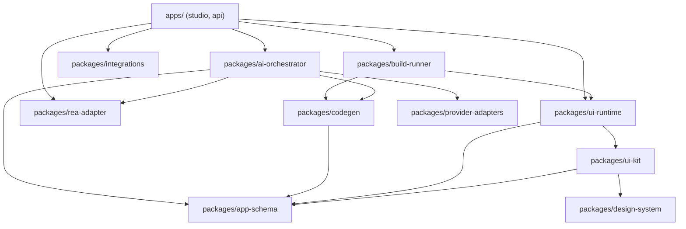
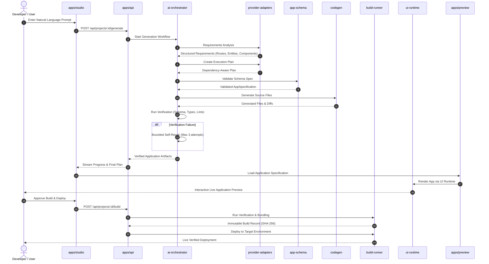

# ForgeOS Architecture

**System:** ForgeOS  
**Category:** AI-Native Application Engineering Platform  
**Status:** Complete & Production-Ready (Phases 1 through 8 Implemented & Verified)  

---

## 1. Architectural Vision

ForgeOS is an end-to-end AI-native application development platform inspired by AppDeploy's developer experience, reverse-engineering inspection tools, reusable component frameworks, autonomous development workflows, and secure build-and-deployment pipelines.

Unlike shallow chatbots that merely return isolated code snippets, ForgeOS is a structured software engineering system. It operates on a formal, versioned, typed application specification (`@forgeos/app-schema`), coordinates multi-step agentic workflows with bounded self-repair (`@forgeos/ai-orchestrator`), renders live previews declaratively (`@forgeos/ui-runtime`), performs safe evidence-based reverse-engineering investigations (`@forgeos/rea-adapter`), provides transactional persistence and encrypted secrets (`@forgeos/integrations`), deterministically generates maintainable source code (`@forgeos/codegen`), and executes verified build-and-deployment pipelines (`@forgeos/build-runner`).

---

## 2. Monorepo Organization & Packages

ForgeOS is organized as a clean TypeScript monorepo using npm workspaces:

```
forgeos/
├── apps/
│   ├── studio/             # Developer IDE, visual builder, requirements, REA hub, build & release
│   ├── api/                # Core backend server, auth, orchestration runner, health checks
│   └── preview/            # Isolated sandboxed application preview host
├── packages/
│   ├── app-schema/         # Versioned typed Zod schemas for application specifications
│   ├── design-system/      # Design tokens (colors, typography, spacing, radii, light/dark)
│   ├── ui-kit/             # Typed component catalog and accessible UI primitives
│   ├── ui-runtime/         # Declarative schema-to-DOM renderer and event coordinator
│   ├── codegen/            # Deterministic TypeScript/React source code generator & diff engine
│   ├── ai-orchestrator/    # Requirements analyzer, planning engine, tool execution, bounded repair
│   ├── provider-adapters/  # Pluggable LLM adapters (Mock, OpenAI, Anthropic, Gemini)
│   ├── rea-adapter/        # Typed adapter interface for Reverse Engineer Anything (Phase 4)
│   ├── build-runner/       # Build, test, checksum, deployment, and rollback pipeline (Phase 7)
│   ├── integrations/       # Database, auth, RBAC, encrypted secrets, audit logs (Phase 6)
│   └── testing/            # Shared test utilities, mocks, and assertion helpers
├── research/
│   └── upstream/           # Upstream candidate clones (audited, isolated from runtime)
├── AGENTS.md
├── ARCHITECTURE.md
├── DECISIONS.md
├── ENVIRONMENT.md
├── IMPLEMENTATION_PLAN.md
├── PROGRESS.md
├── README.md
├── REPOSITORY_AUDIT.md
├── SECURITY.md
├── SKILL.md
└── TECH_STACK.md
```

---

## 3. Dependency Direction & Boundaries

To preserve architectural integrity, package dependencies flow strictly unidirectionally:



### Dependency Rules:
1. `packages/app-schema` is the leaf data contract and has no internal dependencies.
2. `packages/design-system` has no internal dependencies.
3. `packages/ui-kit` depends only on `design-system` and `app-schema`.
4. `packages/ui-runtime` depends on `app-schema` and `ui-kit`.
5. `packages/codegen` depends on `app-schema`. It has no UI or DOM dependencies.
6. `packages/ai-orchestrator` orchestrates planning, tools, and code generation. It communicates via typed schemas.
7. `packages/rea-adapter` validates external targets, isolates untrusted inputs, redacts credentials, and maps observations into `AppSpecification`.
8. `packages/integrations` provides independent ACID persistence, AES-256-GCM secrets, RBAC authentication, and audit trails.
9. `packages/build-runner` performs static verification, production bundling, SHA-256 checksumming, deployment gating, and rollback.
10. `apps/*` depend on packages, but packages never depend on apps.

---

## 4. End-to-End Data Flow



---

## 5. Trust Boundaries & Security Model

1. **Client / Browser Boundary**:
   - Studio and Preview run in browser contexts.
   - Private LLM keys, database credentials, and server secrets are never transmitted to or executed in client bundles.
   - Preview runs in an isolated `iframe` with `sandbox="allow-scripts"` and postMessage messaging.
2. **AI Provider Boundary**:
   - External LLM providers receive prompt context and output JSON/text.
   - Responses are strictly validated by Zod schemas before being accepted.
   - Raw model responses are never evaluated via `eval()` or unconstrained shell execution.
3. **Generated Code Execution Sandbox**:
   - Live preview rendering operates via a declarative runtime (`packages/ui-runtime`) that resolves pre-registered, safe components.
   - No dynamic `eval` or untrusted script injection is permitted in the preview environment. Malicious script tags and event handlers in props are sanitized.
4. **Filesystem Boundary**:
   - File creation and edits by code generators and tools are strictly confined to the project root (`FORGEOS_WORKSPACE_ROOT`). Path traversal (`../`) is blocked by path sanitizers.
5. **Reverse-Engineering & SSRF Boundary**:
   - Target URL inspections are validated against an SSRF deny-list blocking loopback (`127.0.0.1`, `localhost`), link-local (`169.254.0.0/16`), cloud metadata (`169.254.169.254`, `metadata.google.internal`), and RFC 1918 private IPv4 networks.
   - Captured evidence is sanitized with regex masks for API keys, bearer tokens, and secrets.
6. **Authentication & RBAC Boundary**:
   - Strict tier separation (`owner`, `developer`, `viewer`).
   - Production deployments require explicit `owner` or developer approval; unauthenticated or read-only viewers are blocked.
7. **Build & Release Boundary**:
   - Builds compute SHA-256 source and artifact checksums, preventing tampering.
   - Rollbacks restore verified build records atomically.
